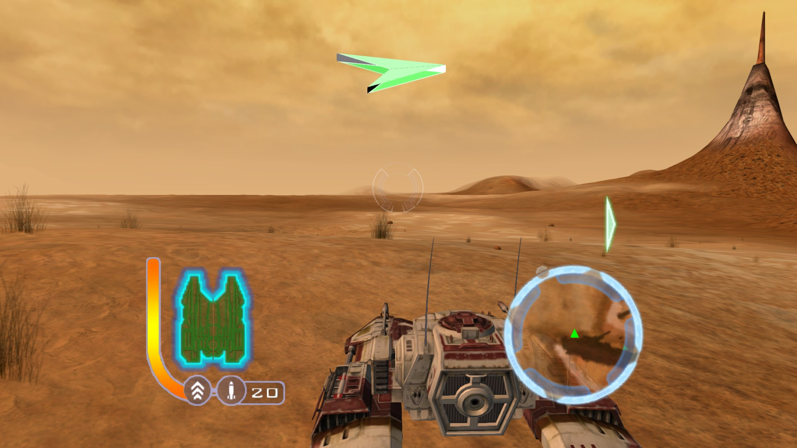
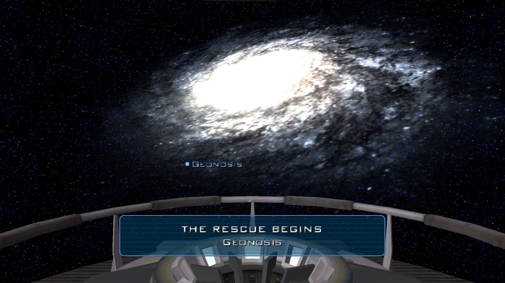
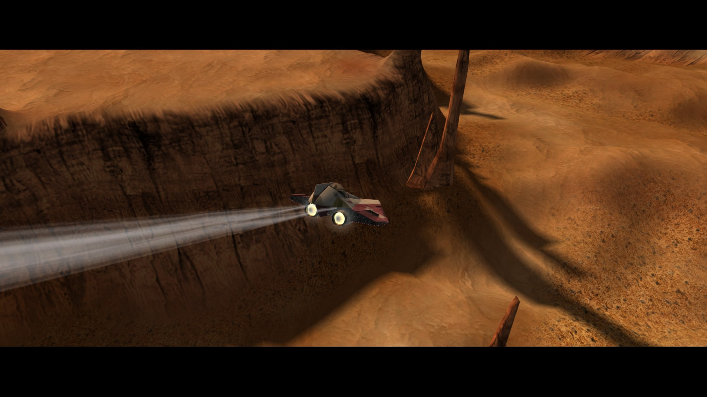
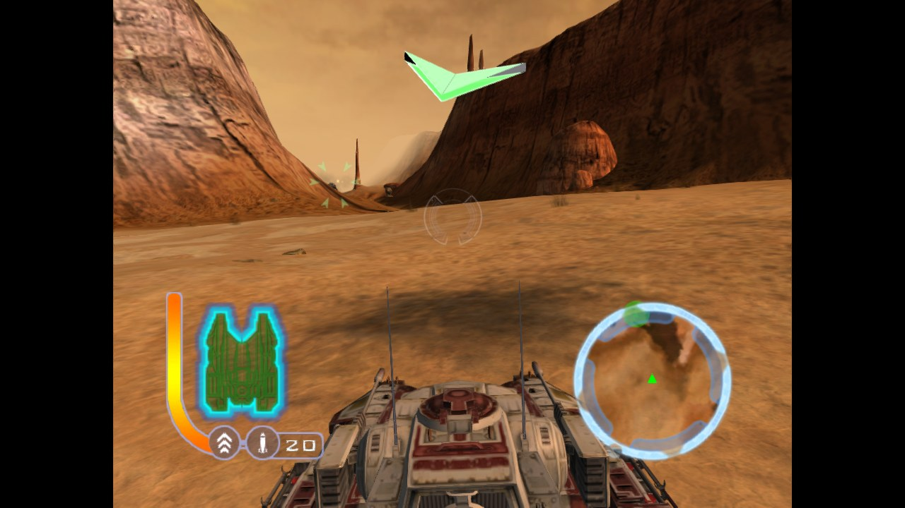
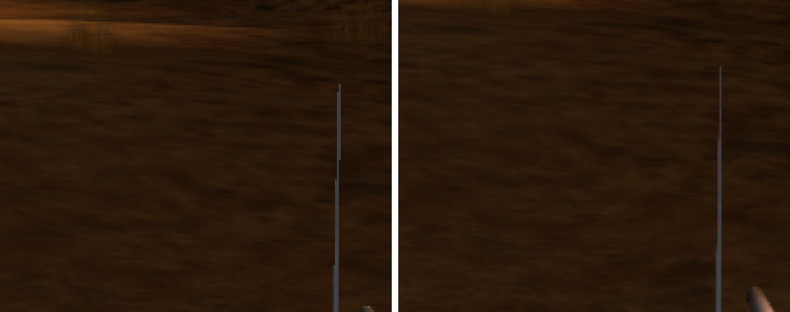

# Star Wars: The Clone Wars — PC

A native Windows port of the 2002 Xbox game *Star Wars: The Clone Wars*
(LucasArts / Pandemic Studios), built by **static recompilation**: the game's
x86 code is translated into C and compiled into a Windows executable. There is
no emulator. Graphics go through Microsoft's real Direct3D 8, sound through the
Windows audio mixer, and controllers through XInput.



**No game data is included.** You need a disc image of your own copy of the
original Xbox game (USA release). The source code in this repository contains
nothing from the game; the build regenerates the translated code from your
`default.xbe`. The ready-to-run `.exe` on the Releases page is built that way:
it contains the game's program code, translated, but none of its graphics,
sound, levels or movies, which come from your disc image.

## Playing

1. Download `CloneWars32.exe` from the
   [Releases](https://github.com/GTTeancum/StarWars-CloneWars-PC/releases) page.
2. Put it in an empty folder together with your disc image (`.iso` or
   `.xiso`, the USA release).
3. Double-click `CloneWars32.exe`.

The first start unpacks the disc image into that folder (about 1.5 GB) and
then starts the game; after that it starts straight away, and the image can
be deleted. Nothing needs to be installed: Windows 10 or 11 is enough.
(Windows "N" editions need Microsoft's Media Feature Pack, for the movies.)

## Features

- Any resolution, windowed or borderless full screen
- True widescreen: the 3D view is widened by the game's own camera, so more of
  the world is visible and nothing is stretched. Menus, HUD and 2D art keep
  their original 4:3 layout, pillarboxed.
- FXAA anti-aliasing
- Locked 60 fps, matching the original's frame pacing
- Xbox controller support, plus keyboard

| | |
|---|---|
|  |  |
| Galaxy map, 1920x1080 | In-engine cutscene, 1920x1080 |
|  |  |
| `Widescreen=0`: the original 4:3 picture | FXAA off (left) and on (right), 3x zoom |

## Settings

`CloneWars.ini` is created next to the executable on first run:

```ini
[Video]
Width=1280        ; 0 = monitor resolution
Height=720
Fullscreen=0      ; 1 = borderless window covering the monitor
Widescreen=1      ; 0 = original 4:3 picture with side bars
FXAA=1
```

Widescreen is supported at 16:9. Ultrawide (21:9 and wider) is not
supported; it runs, but use it at your own risk. At any wide setting, an enemy in the extra side area (outside
the original 4:3 view) gets an off-screen arrow instead of a target marker.

Keyboard: Enter = Start, Esc = Back, arrows = D-pad, WASD = left stick,
Z/X/C/V = A/B/X/Y, Q/E = triggers.

Saves are stored in `%LOCALAPPDATA%\CloneWarsRecomp`.

## Status

Single player is playable, and all 40 maps (campaign, split-screen and the
system-link maps) load and run in an automated test (`tools/smoke_maps.py`).
Known gaps:

- Pre-baked terrain sun shadows are not drawn yet.
- A few pixel shaders fall back to a simplified version.
- Split-screen runs but has had little play-testing; the right edge of each
  player's HUD is slightly cut off.
- Online and system-link play are not supported.

## Building

### Requirements

- Windows 10/11, Visual Studio 2022 (Desktop C++ workload), CMake 3.20+
- Python 3.10+ with `capstone` (`pip install capstone`)
- **DirectX 8.1 SDK** headers and `d3d8.lib`, for the 32-bit renderer
  (default location `C:\Program Files (x86)\DXSDK`, override with
  `-DDXSDK8_DIR=...`)
- Your own dump of the game disc (NTSC-U retail, XBE built 2003-04-04)

### 1. The recompiler toolkit

This project is built on [xboxrecomp](https://github.com/sp00nznet/xboxrecomp)
(MIT). It needs a handful of fixes that live in `patches/xboxrecomp.patch`.
Clone the toolkit next to this repository and apply the patch:

```bash
git clone https://github.com/sp00nznet/xboxrecomp.git
cd xboxrecomp
git checkout 6f55eaa
git apply ../StarWars-CloneWars-PC/patches/xboxrecomp.patch
```

### 2. Generate the translated code from your XBE

Copy your `default.xbe` to `game/default.xbe`, then from the `xboxrecomp`
folder:

```bash
python -m tools.xbe_parser   ../StarWars-CloneWars-PC/game/default.xbe --json ../StarWars-CloneWars-PC/game/analysis.json
python -m tools.disasm       ../StarWars-CloneWars-PC/game/default.xbe -v --force --seed-functions ../StarWars-CloneWars-PC/tools/icall_seed_functions.json -o ../StarWars-CloneWars-PC/tools/disasm
python ../StarWars-CloneWars-PC/tools/merge_fragments.py ../StarWars-CloneWars-PC/tools/disasm/functions.json
python -m tools.func_id      ../StarWars-CloneWars-PC/game/default.xbe -v
python -m tools.abi_analysis ../StarWars-CloneWars-PC/game/default.xbe -v
python -m tools.recomp       ../StarWars-CloneWars-PC/game/default.xbe --all --split 1000 --gen-dir ../StarWars-CloneWars-PC/src/recomp/gen --game-name "Star Wars: The Clone Wars" --disasm-dir ../StarWars-CloneWars-PC/tools/disasm
```

`merge_fragments.py` re-joins functions the disassembler splits after an
early return; without it the game hangs at boot. A function the disassembler
missed shows up at run time as `[ICALL] Failed to resolve VA`: add its
address to `tools/icall_seed_functions.json` and run the three steps again.

Then, from this repository, mark the functions replaced by hand-written code:

```bash
python tools/apply_manual.py
```

### 3. Build

The renderer uses the 32-bit `d3d8.dll`, so build for Win32:

```bash
cmake -S . -B build32 -A Win32
cmake --build build32 --config Release
```

The build copies `CloneWars32.exe` two folders up (`../..`). Arrange the
folders so that lands in your game directory, the folder holding
`default.xbe`, `data.zwp` and the `Data`, `Movies`, `Bins` and `Addon`
folders, or copy the `.exe` and `.pdb` there yourself. Run it from there.

## Source layout

The game runs as a hybrid. The title's x86 code, translated to C, is the
base. Recovered original source replaces it piece by piece as it is verified.

| Path | What it is |
|---|---|
| `src/host/` | Entry point, directory and save setup (`main.c`), controller and keyboard input (`input.c`) |
| `src/platform/` | The title's Xbox libraries replaced: Direct3D 8 renderer with shader translation, widescreen, resolution scaling and FXAA (`d3d8.c`); DirectSound and audio mixer (`dsound.c`); movie playback hooks (`xmv.c`) |
| `src/overrides/` | Hand-written replacements for individual translated functions |
| `src/game/` | Recovered original game source, one file per original source file. `missions/` holds every mission script |
| `src/game/glue/` | Bridge between recovered source and translated code |
| `include/game/` | Shared declarations for the recovered source |
| `tools/` | Seed lists for the disassembler and helper scripts; `gc_*.py` match recovered source to the Xbox build |
| `patches/xboxrecomp.patch` | Changes to the xboxrecomp toolkit |

The recovered source is on by default in the 32-bit build (`CW_RECOVERED_GAME`).
`tools/gc_bind.py` generates the glue after the recovered files change. At run
time, `CW_RECOVERED=0` in the environment runs the translated code instead, and
`CW_BRIDGE_TRACE=1` logs every call the recovered code makes into the engine.

## Credits

- **Shaymin**: the recovered original source in `src/game/`, from their
  matching decompilation of the GameCube version, and the analysis behind it
  (function names, source file layout, data layouts).
- [xboxrecomp](https://github.com/sp00nznet/xboxrecomp) by sp00nz (MIT);
  the patch in `patches/` modifies files from it and is under the same licence.
- Star Wars: The Clone Wars is © Lucasfilm Ltd. This is an unofficial fan
  project and is not affiliated with or endorsed by Lucasfilm, Disney, or
  Electronic Arts.
